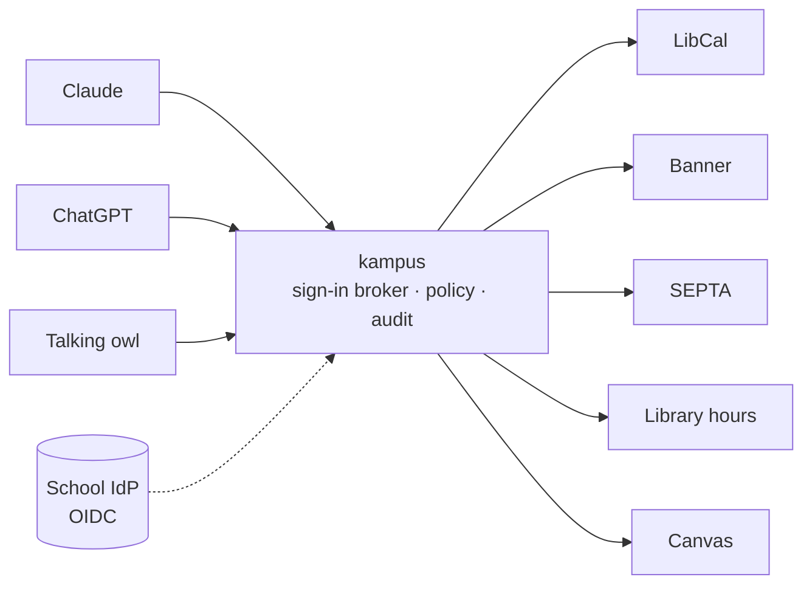

# Kampus

**Your campus, inside the AI assistant you already use.**

Kampus is an open-source [MCP](https://modelcontextprotocol.io) server that connects a university's systems (study rooms, courses, transit, library hours, coursework) to the AI assistants students already use, like Claude and ChatGPT. The school stays in control: it decides **which assistant** may see **which data**, for **which role**, and every call is checked and audited.

🥈 **Runner-up (2nd place) at OwlHacks 2026** (September 2026).

[](LICENSE)


---

## Why

Deadlines live in Canvas, study rooms on the library's booking site, trains in the SEPTA app, courses in Banner. Students already ask an AI assistant about everything, and none of those assistants know anything about their campus.

Universities can't simply let AI assistants into their systems either: student records are protected by FERPA, and schools require security approval before non-public data goes near AI. Kampus is designed so that **students want to use it and a university's IT office could sign off on it**.

## What it does

| Tool | What you can ask | Data | Source |
|---|---|---|---|
| `find_study_room` | "Is there a group room at Charles free at 3?" | Public | LibCal (live; currently failing upstream, see below) |
| `book_study_room` | Propose a booking (nothing is written yet) | Public | LibCal (simulated in the sandbox build) |
| `confirm_booking` | Confirm a proposal (the only write; needs your approval) | Public | LibCal (simulated in the sandbox build) |
| `search_courses` | "Is there a machine learning course in CIS this fall?" | Public | Banner 9 (live) |
| `next_departures` | "When's the next B from Cecil B. Moore going south?" | Public | SEPTA live arrivals and GTFS schedule |
| `library_hours` | "When does Charles Library close today?" | Public | Library website (live) |
| `my_deadlines` | "What's due this week?" | **Sensitive** | Canvas (synthetic in the sandbox build) |

**The same question gets different answers depending on who's asking:**

- **Claude**, registered as the school's *approved* assistant, can read your deadlines.
- **ChatGPT**, on the same server with the same student logged in, is **refused**, because it isn't the school's approved workspace.
- A **talking owl** (a Raspberry Pi kiosk) connects as a public device: it answers campus questions but never touches personal data.

Room search is down for now: LibCal's API began refusing anonymous requests after the fixtures were recorded, and a switch to the public booking page's endpoint is planned ([details](docs/auth/qualification.md#findings-and-owner-decisions-task-77)).

Every decision lands in an audit log that records which feature was used and when, **never what was asked or answered**, with student IDs hashed.

## How it works



- **MCP is a thin outer layer.** Only the `kampus` binary speaks MCP. Modules and vendor adapters exchange plain Rust types and never see tokens.
- **Policy on every call, before any data or cache is touched.** It checks role × tool × data class × which assistant is asking. Tools are never hidden: every caller sees the same list, and refusals are explicit and audited.
- **Standard sign-in, with the school's own accounts.** Kampus is an OAuth resource server that verifies RFC 9068 access tokens (audience = its own resource URL) from one configured issuer. That issuer is either the school's own authorization server or the built-in Kampus broker (`--features broker`), which signs students in through the school's OIDC IdP and keeps no passwords, names or emails. A student adds Kampus to Claude or ChatGPT by pasting one URL (Client ID Metadata Documents); the school's own workspace assistants are pre-registered clients with a secret. Public tools work without signing in; protected calls answer with a 401 or 403 challenge. Only pre-registered clients can be approved for personal data. Tested live with SJU's Google Workspace, Claude and ChatGPT: [docs/auth](docs/auth/README.md).
- **Adapters per vendor, not per school.** One LibCal adapter serves every LibCal school. Everything school-specific lives in two files: `schools/<id>/school.yaml` and `policy.yaml`.
- **Real data first.** Tests run against recorded real responses from every public source (`fixtures/`).

## Schools

| School | Config | Notes |
|---|---|---|
| Temple University | [`schools/temple/`](schools/temple) | Reference school: all seven tools |
| Saint Joseph's University | [`schools/sju/`](schools/sju) | Same binary, one config file: rooms and transit |

Adding a school means writing a `school.yaml` and a `policy.yaml`. See [CONTRIBUTING.md](CONTRIBUTING.md).

## Quickstart

You need Rust 1.99 (pinned in `rust-toolchain.toml`) and `openssl`. Run these from the repository root in a POSIX shell (Git Bash works on Windows).

### Public tools, no sign-in

```bash
git clone <this repo> && cd kampus
cargo build --release -p kampus

# Temple in no-login mode: everyone is a guest, public tools work, personal data is refused.
sed 's/^  mode: oauth/  mode: no_login/' schools/temple/school.yaml > school.local.yaml
export KAMPUS_TEMPLE_AUDIT_SALT=$(openssl rand -hex 32)
./target/release/kampus serve --school school.local.yaml --policy schools/temple/policy.yaml
```

Kampus now serves MCP at `http://127.0.0.1:8080/mcp`. Try it with the [MCP Inspector](https://modelcontextprotocol.io/docs/tools/inspector).

### With the sign-in broker (synthetic demo users)

The demo build adds the broker, synthetic students, the synthetic Canvas and simulated bookings. This runs the fictional trial school from [`deploy/trial/`](deploy/trial/) on your machine:

```bash
cargo build --release -p kampus --features sandbox,broker

sed -e 's#https://trial.kampus.invalid/mcp#http://127.0.0.1:8080/mcp#'     -e 's#https://trial.kampus.invalid/auth#http://127.0.0.1:8082/auth#'     deploy/trial/school.trial.yaml > school.local.yaml
for name in AUDIT_SALT SUBJECT_KEY CLAUDE_SECRET CHATGPT_SECRET; do
  export KAMPUS_TRIAL_$name=$(openssl rand -hex 32)
done
./target/release/kampus serve --school school.local.yaml --policy deploy/trial/policy.trial.yaml
```

The log says `authorization broker listening`. MCP is at `http://127.0.0.1:8080/mcp`, and the broker's metadata at `http://127.0.0.1:8082/.well-known/oauth-authorization-server/auth`. Its signing key is created in `data/auth/`. To sign in by hand (authorize, pick a demo student, consent, token, an MCP call, refresh, disconnect), follow the [curl walkthrough](docs/auth/broker.md#walkthrough-sign-in-with-curl-sandbox-build).

If `CARGO_TARGET_DIR` is set, the binary is under that directory instead of `./target`.

### On a real domain

Claude and ChatGPT need a public HTTPS address. Two ways to get one:

- [deploy/trial](deploy/trial/): one command (`up.sh`) on a server with Docker and a domain: Kampus with the broker behind Caddy.
- [deploy/cloudflare-tunnel](deploy/cloudflare-tunnel/README.md): a named Cloudflare Tunnel in front of a laptop, as used for the live runs.

Then add the `/mcp` URL as a custom connector in Claude or a developer-mode connector in ChatGPT ([student guide](docs/auth/student-assistants.md)). Operators: start with [docs/auth](docs/auth/README.md), then [broker.md](docs/auth/broker.md) and [school-idp.md](docs/auth/school-idp.md) to sign students in with the school's own accounts.

## Repository layout

Kampus is a monorepo: the Rust server, the owl voice client and its hardware.

```
crates/server          the server binary: MCP mapping (rmcp), HTTP router, login middleware, admin page
crates/core            contracts, config, policy, audit, dispatch, output sanitizing
crates/auth            the OAuth sign-in broker (behind the `broker` feature)
crates/device          POST /device/bind: the owl mascot's device binding
adapters/*             vendor adapters: libcal, banner, transit, hours, canvas
modules/*              one folder per capability: module.yaml + a small crate
schools/<id>/          school.yaml and policy.yaml per school
fixtures/              recorded real responses used by tests
clients/owl/           the talking mascot (Python, Raspberry Pi)
hardware/owl/          the mascot's CAD, print files, wiring and parts list
deploy/                the one-command trial, Caddy and Cloudflare Tunnel notes, and the owl's Pi setup
openspec/              the living specification and the change history
docs/                  contracts, auth, transit, device API, demo, research
```

Each part has its own CI (`.github/workflows/server.yml`, `owl.yml`), so a change in one doesn't rebuild the others.

## Development

```bash
cargo fmt --all
cargo clippy --workspace --all-targets -- -D warnings
cargo test --workspace
cargo clippy --workspace --all-targets --features kampus/sandbox,kampus/broker -- -D warnings
cargo test --workspace --features kampus/sandbox,kampus/broker
```

House rules (from [AGENTS.md](AGENTS.md)): no `unsafe` (the workspace forbids it), no school-specific values in code, sandbox code only behind the `sandbox` feature, and tests against recorded real responses.

## Status and roadmap

Kampus is a hackathon prototype, not production software. Personal data in the demo is synthetic, and bookings are simulated. Sign-in through a real school account works: the broker has been run live against Saint Joseph's University's Google Workspace with Claude and ChatGPT ([record](docs/auth/qualification.md)).

Next up:
- A published-timetable fallback for Regional Rail, so late-night trips still get an answer
- A fast "list distinct courses" option, and course descriptions and prerequisites from Banner
- Dining, events and building information
- Room search through LibCal's public booking endpoint, and times in the school's time zone
- Real Canvas access through a per-user token vault
- The security and accessibility review a university would require

## Docs

- [Research report](docs/research/campus-ai-connector-report.md): the original plan and the research behind it
- [Contracts](docs/contracts/README.md) · [Auth](docs/auth/README.md) · [Add Kampus to your assistant](docs/auth/student-assistants.md) · [Transit](docs/transit/README.md) · [Device API](docs/device-api/README.md)
- [Demo script](docs/demo/script.md)

## License

[Apache-2.0](LICENSE)
