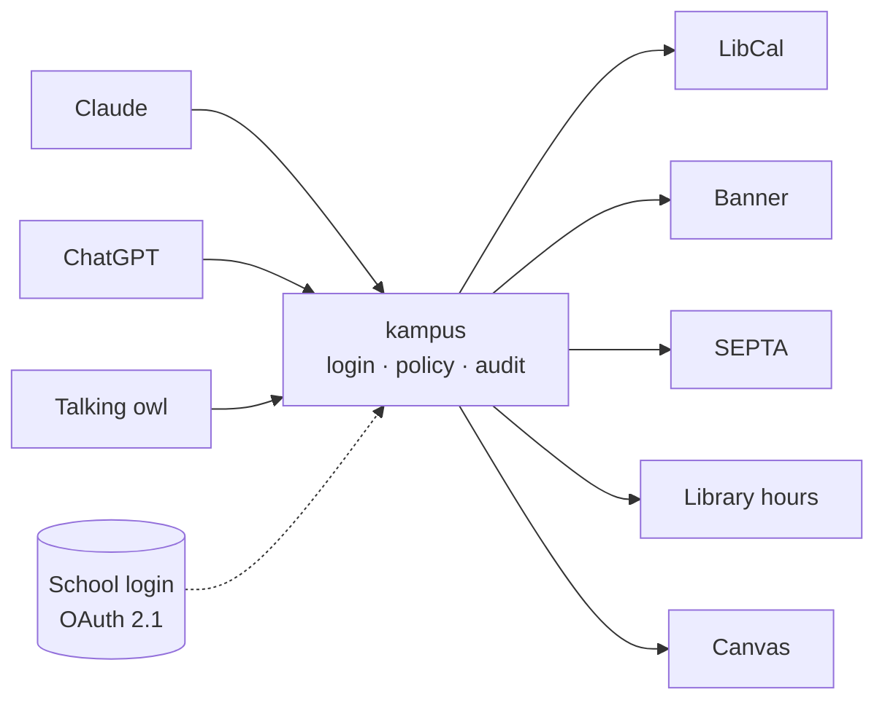

# kampus

**Your campus, inside the AI assistant you already use.**

kampus is an open-source [MCP](https://modelcontextprotocol.io) server that connects a university's systems (study rooms, courses, transit, library hours, coursework) to the AI assistants students already use, like Claude and ChatGPT. The school stays in control: it decides **which assistant** may see **which data**, for **which role**, and every call is checked and audited.

🥈 **Runner-up (2nd place) at OwlHacks 2026** (September 2026).

[](LICENSE)


---

## Why

Deadlines live in Canvas, study rooms on the library's booking site, trains in the SEPTA app, courses in Banner. Students already ask an AI assistant about everything, and none of those assistants know anything about their campus.

Universities can't simply let AI assistants into their systems either: student records are protected by FERPA, and schools require security approval before non-public data goes near AI. kampus is designed so that **students want to use it and a university's IT office could sign off on it**.

## What it does

| Tool | What you can ask | Data | Source |
|---|---|---|---|
| `find_study_room` | "Is there a group room at Charles free at 3?" | Public | LibCal (live) |
| `book_study_room` | Propose a booking (nothing is written yet) | Public | LibCal (simulated in the sandbox build) |
| `confirm_booking` | Confirm a proposal (the only write; needs your approval) | Public | LibCal (simulated in the sandbox build) |
| `search_courses` | "Is there a machine learning course in CIS this fall?" | Public | Banner 9 (live) |
| `next_departures` | "When's the next B from Cecil B. Moore going south?" | Public | SEPTA live arrivals and GTFS schedule |
| `library_hours` | "When does Charles Library close today?" | Public | Library website (live) |
| `my_deadlines` | "What's due this week?" | **Sensitive** | Canvas (synthetic in the sandbox build) |

**The same question gets different answers depending on who's asking:**

- **Claude**, registered as the school's *approved* assistant, can read your deadlines.
- **ChatGPT**, on the same server with the same student logged in, is **refused**, because it isn't the school's approved workspace.
- A **talking owl** (a Raspberry Pi kiosk) connects as a public device: it answers campus questions but never touches personal data.

Every decision lands in an audit log that records which feature was used and when, **never what was asked or answered**, with student IDs hashed.

## How it works



- **MCP is a thin outer layer.** Only the `kampus` binary speaks MCP. Modules and vendor adapters exchange plain Rust types and never see tokens.
- **Policy on every call, before any data or cache is touched.** It checks role × tool × data class × which assistant is asking. Tools are never hidden: every caller sees the same list, and refusals are explicit and audited.
- **Standard sign-in, any compliant issuer.** kampus is an OAuth resource server that verifies RFC 9068 access tokens (audience = its own resource URL) from one configured issuer: the school's own authorization server, or the kampus broker from the upcoming `auth-broker` change. Public tools work without signing in; protected calls answer with a 401 or 403 challenge. Approved assistants are pre-registered confidential clients; anything that registers itself is unapproved.
- **Adapters per vendor, not per school.** One LibCal adapter serves every LibCal school. Everything school-specific lives in two files: `schools/<id>/school.yaml` and `policy.yaml`.
- **Real data first.** Tests run against recorded real responses from every public source (`fixtures/`).

## Schools

| School | Config | Notes |
|---|---|---|
| Temple University | [`schools/temple/`](schools/temple) | Reference school: all seven tools |
| Saint Joseph's University | [`schools/sju/`](schools/sju) | Same binary, one config file: rooms and transit |

Adding a school means writing a `school.yaml` and a `policy.yaml`. See [CONTRIBUTING.md](CONTRIBUTING.md).

## Quickstart (local, no login)

You need Rust 1.96 (pinned in `rust-toolchain.toml`).

```bash
git clone <this repo> && cd kampus
cargo build --release -p kampus

# Run Temple in no-login mode: everyone is a guest, public tools work, personal data is refused.
sed 's/^  mode: oauth/  mode: no_login/' schools/temple/school.yaml > school.local.yaml
export KAMPUS_TEMPLE_AUDIT_SALT=$(openssl rand -hex 32)
./target/release/kampus serve --school school.local.yaml --policy schools/temple/policy.yaml
```

kampus now serves MCP at `http://127.0.0.1:8080/mcp`. Try it with the [MCP Inspector](https://modelcontextprotocol.io/docs/tools/inspector), or put a tunnel in front of it and add it as a custom connector in Claude or an app in ChatGPT.

For the full setup, with the synthetic Canvas and booking (`--features sandbox`) and a public domain, see [docs/development](docs/development/README.md), [docs/auth](docs/auth/README.md) and [deploy/cloudflare-tunnel](deploy/cloudflare-tunnel/README.md). The repository ships no authorization server until the `auth-broker` change lands; until then, protected calls get a 401.

## Repository layout

```
crates/kampus          the binary: MCP mapping (rmcp), HTTP router, login middleware, admin page
crates/kampus-core     contracts, config, policy, audit, dispatch, output sanitizing
crates/kampus-*        vendor adapters: libcal, banner, transit, hours, canvas; device binding
modules/*              one folder per capability: module.yaml + a small crate
schools/<id>/          school.yaml and policy.yaml per school
fixtures/              recorded real responses used by tests
openspec/specs/        the living specification
deploy/                Caddy and Cloudflare Tunnel deployment notes
docs/                  contracts, auth, transit, device API, demo, research
```

## Development

```bash
cargo fmt --all
cargo clippy --workspace --all-targets -- -D warnings
cargo test --workspace
cargo clippy --workspace --all-targets --features kampus/sandbox -- -D warnings
cargo test --workspace --features kampus/sandbox
```

House rules (from [AGENTS.md](AGENTS.md)): no `unsafe` (the workspace forbids it), no school-specific values in code, sandbox code only behind the `sandbox` feature, and tests against recorded real responses.

## Status and roadmap

kampus is a hackathon prototype, not production software. Personal data in the demo is synthetic, and bookings are simulated.

Next up:
- A published-timetable fallback for Regional Rail, so late-night trips still get an answer
- A fast "list distinct courses" option, and course descriptions and prerequisites from Banner
- Dining, events and building information
- Real Canvas access through a per-user token vault, and a real school login
- The security and accessibility review a university would require

## Docs

- [Research report](docs/research/campus-ai-connector-report.md): the original plan and the research behind it
- [Contracts](docs/contracts/README.md) · [Auth](docs/auth/README.md) · [Transit](docs/transit/README.md) · [Device API](docs/device-api/README.md)
- [Demo script](docs/demo/script.md)

## License

[Apache-2.0](LICENSE)
