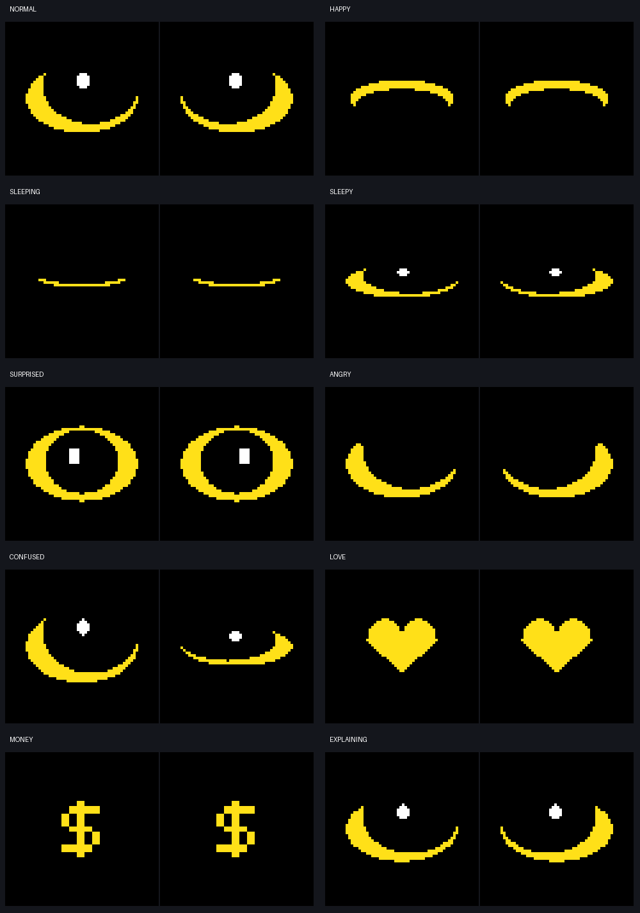

# Kampus hardware

Raspberry Pi 5 robot with two GC9A01 round displays, a USB webcam/microphone, and a Bluetooth speaker.

## Talking owl project

The complete new project is in **[owl-pi](owl-pi/README.md)**. It includes the eye renderer, display driver, local wake listening, online AI voice connection, audio support, optional camera, configuration, dependency list, and offline tests.

- Start the robot: `python main.py` from inside `owl-pi`, after following its setup guide.
- Test only the screens: `python main.py --demo`.
- Run the software checks: `python -m unittest discover -s tests -v`.
- **`owl-pi/tests/test_owl.py` is a test suite, not the robot startup program.** Its `from eyes ...` import loads the supplied `owl-pi/eyes.py` file.

The new project's default wiring matches the existing Pi eye test: left DC GPIO25, right DC GPIO24, left reset GPIO27, right reset GPIO22, and SPI0 CE0/CE1. It uses 3.3 V screen power. See the full wiring table before connecting anything.



## Continue on another laptop

```bash
git clone --branch eyes https://github.com/hienle0401/kampus_hardware_version.git
cd kampus_hardware_version/owl-pi
```

You can edit the code on that laptop; the hardware application runs on the Pi. For offline software tests on a laptop with Python 3.11 or newer, install `numpy` and `Pillow`, then run the test command above. No Pi, API key, mic or camera is needed for those tests.

API keys and downloaded speech models are not committed. Copy `.env.example` to `.env` locally and follow the guide to download the wake model. Never commit `.env`.

## Existing hardware baseline

The original `eyes_test.py`, Arduino sketch under `eyes_test/`, and [HANDOFF.md](HANDOFF.md) remain available. Follow the handoff's rule to work on **`eyes`** and have the other collaborator review before merging to `main`. Ask the Pi owner before installing system packages or changing system settings.

The new project passes offline tests but still needs real Pi/display/audio and live API testing. Existing baseline hardware status is documented in the handoff.
